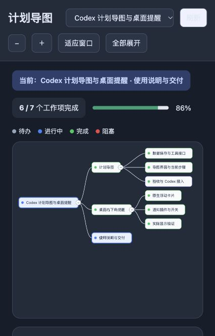

# plan-map

把**用户给的计划**持久化成一张可视化计划树：阶段、当前步骤、完成/阻塞状态与进度。
展示的是用户的计划内容，不是 AI 的思考流水。

同一个东西有两个宿主版本——两个宿主的能力不同，所以形态不同，但**共享同一套计划语义**
（层级由大纲缩进或 markdown 决定、状态只前进不回退、节点可带备注）。

| 版本 | 宿主 | 形态 | 工具 | 界面 |
|---|---|---|---|---|
| [`dsh/`](dsh) | DeepSeek Harness | 主机插件（`@local/dsh-plan-map`） | `plan_import`、`plan_node` | 右侧边栏 Plan Map Tab（客户端 slot，SVG 树）+ `/planmap` |
| [`codex/`](codex) | Codex | 技能（`SKILL.md`）+ MCP 服务器 | `plan_list`、`plan_import`、`plan_node`、`plan_view` | MCP App 内嵌面板，或 `plan_view` 返回的本地 viewerUrl |

## dsh/ —— DeepSeek Harness 插件

- 主机侧 `lib/index.js` 注册两个工具并把计划折叠成 `planTree` 投影；客户端 `lib/client.js` 渲染右侧栏树。
- 计划树**从官方事件折叠**（`tool/call` 里的 `plan_node`/`plan_import`/`exit_plan_mode`、`todo/write` 推进状态），
  不写任何自定义事件类型——自定义事件会让会话日志整份拒读（见工作区 `docs/architecture.md` §5.1）。
- 2026-10-16 修复：`tool/ptc-dispatch` 事件现在与 `tool/call` 一起折叠，PTC 派发的计划工具调用也能进树。
- 安装（本机 profile 手工装法）：`pnpm add file:<本目录>` 装依赖，再在 profile 的
  `cordis.patch.yml` 里加一行 insert 启用。**不要**写进 `dsh.profile.bundles`：
  官方新版内置的 `dsh-plugin-manager` 会重算 bundles，把非它启用的条目清掉。
- 验证：`node --test`（本机实测 56 项全绿：大纲解析 / 导入 / 自动打标 / 增删改查 / 折叠 / 布局 / 卡片 / 接线）。

## codex/ —— Codex 技能 + MCP 服务器

- `server.js` 是 stdio MCP 服务器，`store.js` 负责带版本号的持久化（防相互覆盖），
  `web/` 是计划面板；`skills/plan-map/SKILL.md` 是让 Codex 主动使用它的技能文件；
  `plugin.json` / `mcp.json` 是分发包描述。
- 安装：`npm install`；注册 `codex mcp add plan-map -- node <本目录>/server.js`；
  把 `skills/plan-map/` 放到 `~/.codex/skills/plan-map/`。跨电脑必须在目标机装依赖并注册命令。
- 验证：`npm test`（本机实测 23 项：存储、真实 MCP 协议、内嵌视图、视口、历史/待办桥接）；浏览器交互验收用 `acceptance/ui.py`（需 Playwright）。
- 计划数据落在 `~/.codex/plan-map/<planId>.json`（`PLAN_MAP_HOME` 可改），**不进仓库**。
- 注意：`skills/plan-map/SKILL.md` 里保留了本机源码路径（`E:/AI-Workspace/Projects/Shared/Plan-Map/codex/`）；
  仓库内的对应内容是 `codex/`，换机使用时按本目录路径调整。

## 版本

- Codex 版：`0.6.0`（MCP App `ui://xinshi-plan-map/v8.html`，v3–v7 兼容），`plan_batch`/`plan_history`/`plan_dashboard` 与宿主待办桥接见 [codex/README.md](codex/README.md)。
- DSH 版：`0.1.1`（含 `tool/ptc-dispatch` 折叠修复）。

## 两个版本的关系

不共享存储。跨宿主想用同一份计划，就在两边用同一段大纲各导入一次；两边都不会去读或改对方的存储。

## 来源

本仓库内是本机版本的快照（2026-10-16）：

- `dsh/` ← `E:/AI-Workspace/Projects/Shared/Plan-Map/dsh/`
- `codex/` ← `E:/AI-Workspace/Projects/Shared/Plan-Map/codex/`（已排除 `node_modules`）
